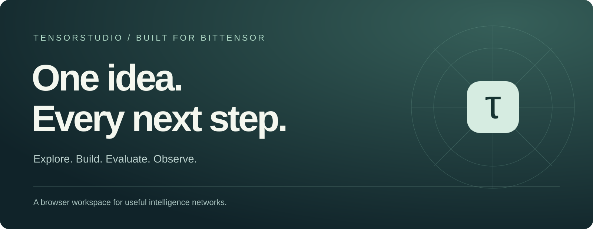
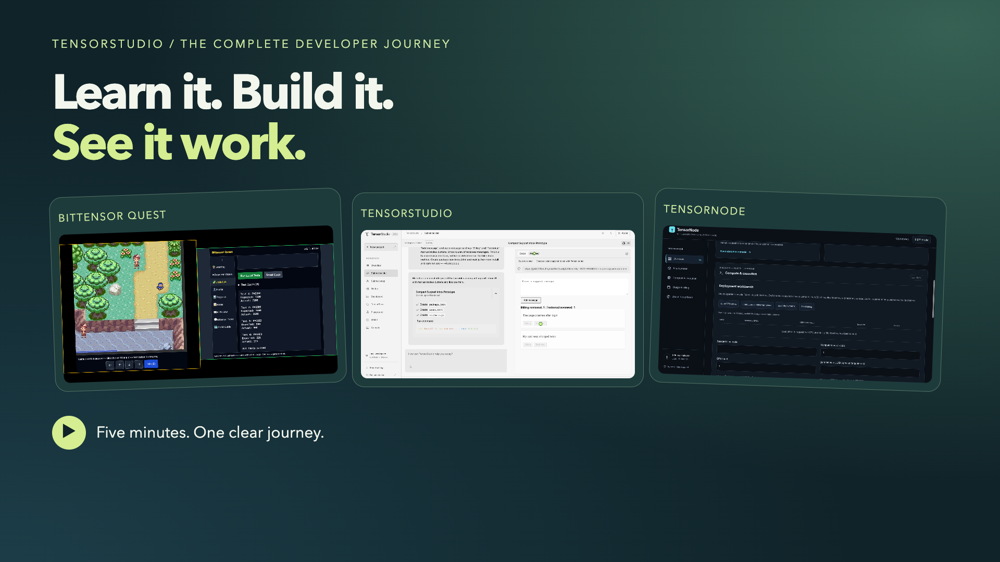
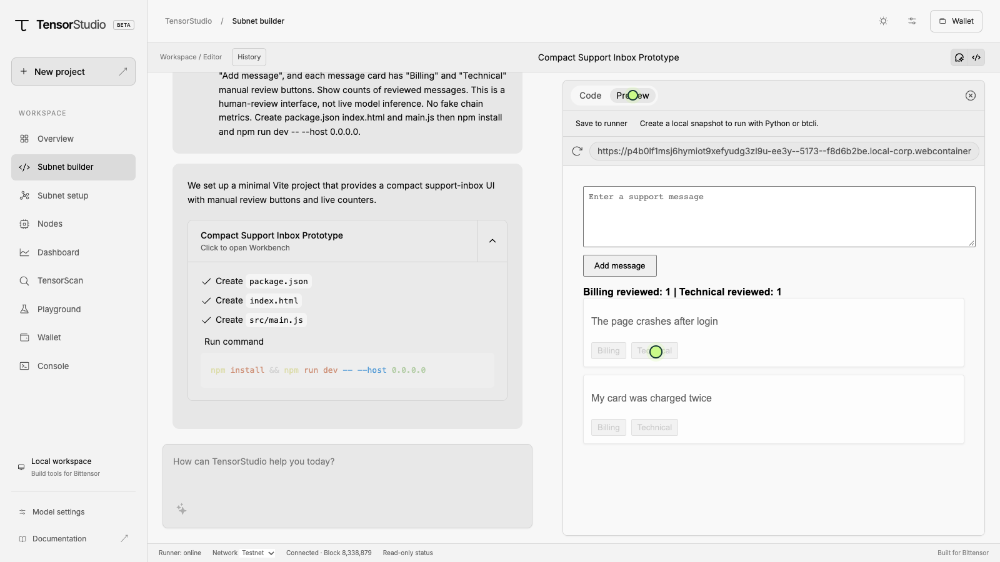
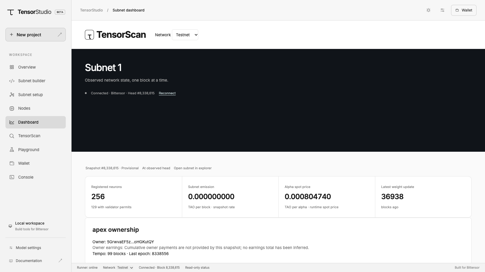
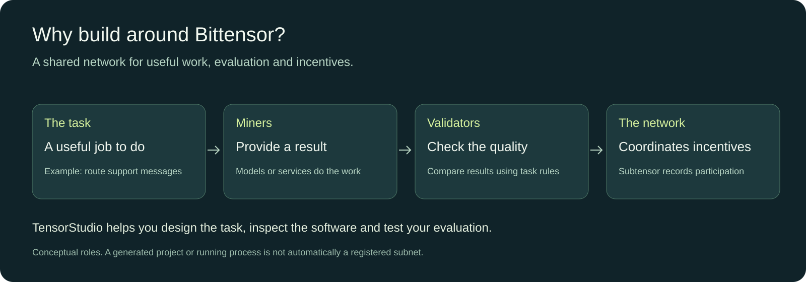
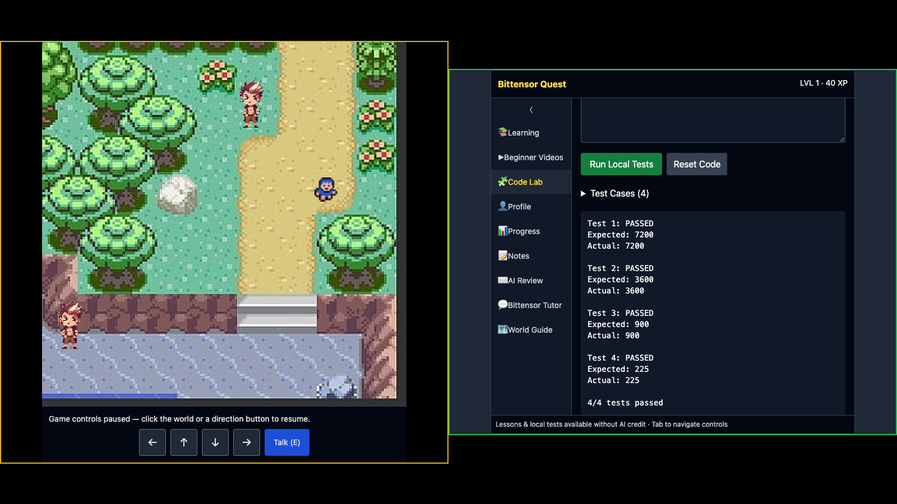
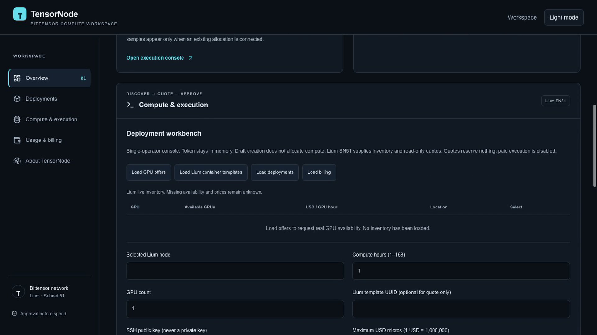
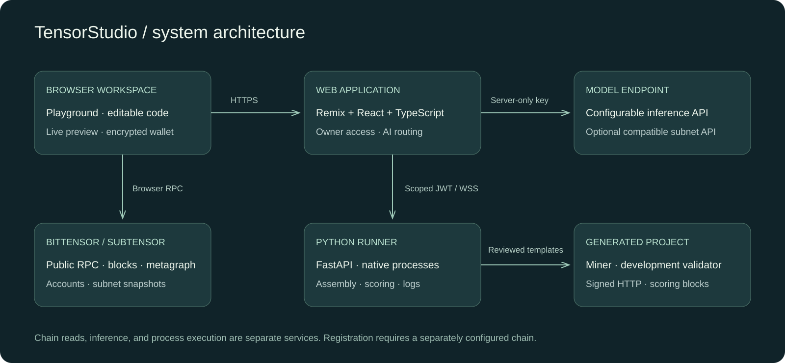

<div align="center">



**Turn an AI idea into a project you can inspect, test and run.**

A guided browser workspace for people exploring and building on Bittensor.

[](https://www.bittensor.com/)


[Open TensorStudio](https://tensorstudio-workbench.vercel.app) · [Watch the five-minute journey](docs/media/TensorStudio-developer-journey-5min.mp4) · [Three-minute pitch](docs/pitch/README.md) · [Project brief PDF](docs/resources/TensorStudio-Project-Brief.pdf)

</div>

> **A small credit budget. A bigger idea.**
>
> I built TensorStudio while running short on Codex and Claude credits. The heart of this project is the problem it tackles: helping people move from learning Bittensor to building, testing and understanding a useful AI service. Look beyond the visual polish and explore the idea, the workflow and the problems it can help solve.
>
> **Give it five minutes—or watch at 1.5× or 2× for a quick tour.** [Watch the demo](docs/media/TensorStudio-developer-journey-5min.mp4), then [try TensorStudio](https://tensorstudio-workbench.vercel.app). Click around, test the workflow and tell me what you would build next. There is a lot here to explore.

[](docs/media/TensorStudio-developer-journey-5min.mp4)

## From a useful idea to an inspectable system

A Bittensor subnet needs more than a model. It needs a useful task, a way to evaluate answers, software that can run that task, and visibility into what the network actually does.

Those pieces often live in different editors, terminals, scripts and explorers. TensorStudio brings the development loop into one workspace: **describe a problem, build an interface, assemble a task-specific project, test its scoring, run processes and inspect the chain.**

You can start with a plain-language idea. Running your own services requires configuration and technical experience; the public explorer and learning path offer a starting point before that step.

| Who it helps | A useful first outcome |
| --- | --- |
| Curious newcomers | Learn the roles, explore a live network and see how a project fits together |
| Founders and product teams | Turn a problem into a concrete interface and a measurable task |
| Researchers | Inspect how labelled examples and scoring rules affect an evaluation |
| Developers and operators | Review generated code, run processes and inspect logs and chain observations |

<details>
<summary><strong>New to the terms? A 30-second glossary</strong></summary>

| Word | Plain meaning |
| --- | --- |
| Subnet | A network focused on a particular job |
| Miner | A participant or service doing that work |
| Validator | A participant evaluating results |
| Inference | Asking a model to produce an answer |
| Ground truth | Reviewed reference answers used for evaluation |
| Runner | The service that executes your project and streams output |
| Netuid | The identifying number of a Bittensor subnet |

</details>

## The problem we solve

| Builder friction | The TensorStudio workflow |
| --- | --- |
| An idea is hard to turn into a concrete starting point | A guided assistant asks questions and suggests practical next steps |
| UI prototypes and subnet logic grow in disconnected tools | Editable code, browser previews and subnet project assembly share one workspace |
| Incentive design is difficult to inspect | Explicit task, ground-truth, scoring and weight blocks |
| A successful-looking demo can hide weak evaluation | Offline fixture reports expose how scoring treats correct, copied, incorrect, slow and empty answers |
| Process state and chain state are easily confused | Native process controls and public chain observations have separate views |
| Bittensor is difficult to approach as a beginner | Contextual network tools and a Bittensor Quest learning link |

## A workspace that follows the work

### Explore → Build

Use the playground to shape an idea, review a plan and carry context into the **Subnet builder**. Inspect generated files and try the result in a real browser preview.



### Define → Evaluate

In **Subnet setup**, describe a question-answering or classification task and supply labelled JSONL data. The assistant selects schema-validated building blocks. The runner assembles reviewed templates and checks the code. An offline harness makes the scoring behavior visible before a team relies on it.

### Run → Observe

Manage generated miner and development-validator processes through Nodes. Inspect logs, stop or restart a process, and run authenticated commands in the console. Open **TensorScan** and the subnet dashboard to inspect real chain observations, public addresses and neuron information.



## Why Bittensor

Bittensor lets independent teams organize specialized AI services around shared evaluation and incentives. A **subnet** is a network focused on a particular task. **Miners** provide answers or services; **validators** check their quality. The network can reward contributions according to its rules.

That makes a useful question central to building: *what work should this service do, and how will we recognize a good result?* TensorStudio brings that question into the same workspace as the interface, code, evaluation and network explorer. It helps teams investigate an idea before making claims about real-world quality or network earnings.



| Bittensor concept | How TensorStudio uses it |
| --- | --- |
| Subtensor | Reads live headers, finality, blocks, events and runtime metadata through RPC |
| Subnets and metagraphs | Displays subnet snapshots, neuron identities, validator permits and available metrics |
| Hotkeys and signed requests | Generated miner/validator templates use the SDK's signed HTTP authentication |
| Task evaluation | QA/classification recipes make ground truth and scoring choices explicit |
| Weights | Offline reports calculate proposed local weights; development validator execution is separate |
| Wallets | Encrypted browser-local key storage and network-aware wallet tools |

**Inference and the chain are separate connections.** The assistant uses a configurable model endpoint. A compatible subnet inference service can be configured as that endpoint; this repository does not claim the hosted assistant is served by a registered TensorStudio subnet. Starting a miner process is separate from registration, on-chain serving, accepted weights and rewards.

Read the [Bittensor integration guide](docs/BITTENSOR-INTEGRATION.md) and [official network concepts](https://www.bittensor.com/docs/concepts/network).

## One ecosystem, distinct tools


| Tool | What you use it for | Availability |
| --- | --- | --- |
| **[TensorStudio](https://tensorstudio-workbench.vercel.app)** | Shape an idea, build an interface, assemble a task project and inspect its evaluation | Hosted workspace; execution requires owner sign-in |
| **[TensorScan](https://tensorscan.vercel.app/scan?network=test)** | Explore public testnet blocks, events, addresses and subnet data | Public read-only explorer |
| **[Bittensor Quest](https://bittensor-quest-learn.someshtalligeri12.chatgpt.site/#game)** | Learn Bittensor through a game-oriented experience | Public learning site; progress stays in your browser |
| **[TensorNode](https://github.com/SomeshTalligeriDEV/tensornode)** | Review operator jobs, events and billing information | Separate private repository; demonstrated with zero-spend drafts |
| **[Subnet Factory](https://github.com/aditya-541/sub)** | Develop a contribution-based project-generation backend | Separate public development project; proposed future integration |

These tools have separate deployment and trust boundaries. TensorNode is not integrated into this Studio deployment, and Subnet Factory is not a deployed subnet powering the hosted assistant. See the [ecosystem guide](docs/resources/ECOSYSTEM.md) for source links, demonstrations and current limits.

### Learn by playing; operate with a clear record

[**Bittensor Quest**](https://bittensor-quest-learn.someshtalligeri12.chatgpt.site/#game) turns the vocabulary into lessons, quizzes and small code simulations. The combined film completes a quiz and four local code tests, then checks learning progress.

[**TensorNode**](https://github.com/SomeshTalligeriDEV/tensornode) is the separate compute-operator project. Its [recorded working demo](https://github.com/SomeshTalligeriDEV/tensornode/blob/main/media/application-demo/TensorNode-professional-working-demo.mp4) creates a zero-spend draft, reads persisted events/billing and cancels the unallocated draft. Its first provider target is Lium SN51; paid GPU execution is not shown.

<details>
<summary>See the actual Quest and TensorNode interfaces</summary>





</details>

## System architecture



1. **Browser workspace:** React UI, editable files, WebContainer previews, encrypted wallet storage and bounded browser chain history.
2. **Web application:** Remix server routes validate AI requests, route inference and protect owner operations. Provider credentials remain server-side.
3. **Runner:** FastAPI assembles reviewed project files, evaluates fixtures, manages native processes and streams command output.
4. **Generated project:** Miner inference, signed requests, development-validator logic, scoring blocks and supplied evaluation data.
5. **Subtensor:** Independent RPC observations feed TensorScan and the dashboard. A separate development chain is required for private-chain workflows.

Hosted runner access uses short-lived scoped sessions and TLS. The owner console executes trusted code; it is not a public multi-user sandbox. [Architecture and operations PDF](docs/resources/TensorStudio-Architecture-Guide.pdf)

## Start building

### Open the hosted workspace

Visit **[tensorstudio-workbench.vercel.app](https://tensorstudio-workbench.vercel.app)**. The landing page and read-only explorer are public; execution tools require the workspace owner's sign-in. Never publish those credentials.

### Run locally

Requirements: **Node 20+ · pnpm 10.15 · Python 3.11 · uv · Chrome/Chromium**.

```bash
pnpm install --frozen-lockfile
uv sync --project apps/runner --python 3.11 --locked
python3 scripts/setup-local.py
pnpm dev:all
```

Open `http://localhost:5173`. The runner uses port `8787`.

Set your model endpoint, API key and model ID in `apps/web/.env.local`. Configure `BITCODE_MODEL_BASE_URL`, `BITCODE_MODEL_API_KEY` and `BITCODE_MODEL_ID` in `apps/runner/.env.local` for miner inference. The setup script pairs local runner credentials. Environment files and keys must remain outside version control.

Use a model available from your chosen service. For private-chain work, configure `CHAIN_WS` to your own development chain. Select public Testnet to explore without deploying a chain.

### Try the complete development loop

[Read the illustrated beginner journey](docs/resources/BEGINNER-JOURNEY.md) · [Download the guide PDF](docs/resources/TensorStudio-Beginner-Journey.pdf)

| Step | What to do | What you should see |
| --- | --- | --- |
| **1 · Learn** | Open [Quest](https://bittensor-quest-learn.someshtalligeri12.chatgpt.site/#game) if Bittensor is new to you, then return to Studio. | Lessons, quizzes and local code simulations |
| **2 · Describe** | Open **Playground**. Describe who needs help and a task with a checkable answer, such as sorting support requests. | A conversation and suggested next steps |
| **3 · Build** | Open **Subnet builder** to prototype the interface; app suggestions also open it directly. Review the files and interact with the browser preview. | An editable starting project and interface |
| **4 · Define** | Open **Subnet setup**. Describe a question-answering or classification task and supply labelled JSONL examples (one example per line). | A recipe showing the task, reference answers and scoring rules |
| **5 · Assemble** | Review the recipe blocks, then assemble the project. | Generated files you can inspect |
| **6 · Evaluate** | Run the offline harness: a local test of how the scoring treats example answers. Open its saved report. | Scores and proposed local weights (relative scores), including weak or empty answers |
| **7 · Run** | With owner access and inference configured, open **Nodes** and launch a generated miner using valid public identity values. | A process status and logs; **Console** supports authorized runner commands |
| **8 · Observe** | Open **TensorScan** and **Dashboard**, select the intended network and inspect its data. | Independent chain observations, separate from your process status |
| **9 · Operate** | Open the separate [TensorNode project](https://github.com/SomeshTalligeriDEV/tensornode). Follow its setup guide or watch its working demo. | A compute-operations workflow for zero-spend drafts, events and billing; it needs its own runtime |

Steps 3–7 need a configured workspace. A running local process does not establish network registration, accepted work or rewards.

Example **format** for a small classification dataset; replace this illustrative data with reviewed data for your actual task:

```jsonl
{"input":"Please refund my invoice","answer":"billing"}
{"input":"The page crashes after login","answer":"technical"}
```

The assembler requires 2–1,000 unique inputs. Classification requires 2–32 distinct labels. An evaluation dataset is not a model benchmark by itself.

## Routes at a glance

| Route | Purpose |
| --- | --- |
| `/playground` | Guided conversation, suggestions and network tools |
| `/editor` | Subnet builder: code, terminal and browser preview |
| `/subcreate` | Task recipes, project assembly and offline scoring |
| `/nodes` | Native process lifecycle and logs |
| `/scan` | Blocks, calls, events, addresses and subnet reads |
| `/dashboard/1?network=test` | A public testnet subnet snapshot |
| `/wallet` | Browser-local wallet tools |
| `/harness?id=…` | Saved offline evaluation report |
| `/runner` | Authenticated command execution |

## Sustainable business model

TensorStudio can sell developer productivity and reliable infrastructure around Bittensor. Potential products include team workspaces, managed isolated runners, private evaluations, hosted observability and integration services. These are proposed revenue streams, not claims of existing sales or guaranteed network earnings.

A practical path is to offer self-hosted development tools, validate demand for paid team workflows, then price managed compute and storage transparently. Subnet token emissions are separate from software revenue. See [business model and unit economics](docs/resources/BUSINESS-MODEL.md).

## Documentation and resources

- **[Beginner journey PDF](docs/resources/TensorStudio-Beginner-Journey.pdf)** — follow Quest, Studio, TensorScan and TensorNode step by step.
- **[Project brief PDF](docs/resources/TensorStudio-Project-Brief.pdf)** — problem, product, Bittensor fit and business direction.
- **[Architecture guide PDF](docs/resources/TensorStudio-Architecture-Guide.pdf)** — components, request flow, security boundaries and deployment.
- **[Three-minute pitch](docs/pitch/README.md)** — narrated video, script and presenter timing.
- **[Learning and technical resources](docs/resources/RESOURCES.md)** — official Bittensor references, SDKs and design acknowledgements.
- **[Deployment guide](docs/DEPLOYMENT-RELEASE.md)** — hosting configuration and operational boundaries.
- **[Ecosystem guide](docs/resources/ECOSYSTEM.md)** — Studio, TensorScan, Quest, TensorNode and Subnet Factory source and status.
- **[Bittensor Quest](https://bittensor-quest-learn.someshtalligeri12.chatgpt.site/#game)** — lessons, quizzes and code simulations, with browser-local progress.
- **[Standalone TensorScan](https://tensorscan.vercel.app/scan?network=test)** — public testnet explorer.

## Development

```bash
pnpm typecheck
pnpm test
pnpm test:runner
pnpm build
```

```text
apps/web/       Remix + React workbench and server routes
apps/runner/    FastAPI execution service and subnet templates
packages/chain/ shared chain code
scripts/        local setup, verification and packaging
infra/          infrastructure configuration
docs/           architecture, guides, pitch and resources
```

Source: **[private Studio repository](https://github.com/SomeshTalligeriDEV/tensor_studio-)** · [Web application](https://github.com/SomeshTalligeriDEV/tensor_studio-/tree/main/apps/web) · [Runner and templates](https://github.com/SomeshTalligeriDEV/tensor_studio-/tree/main/apps/runner). Private repository links require access.

## Operating boundaries

The hosted demonstration uses a free runner that may sleep; project files and process state are ephemeral across restarts. Offline harness timing is simulated. A private development chain is not included in the hosted deployment. Registration, serving, accepted weights, rewards and wallet-signing acceptance require separate end-to-end validation. Mainnet writes are not part of this demo.

Preserve [upstream application licensing](apps/web/LICENSE) and [third-party notices](apps/web/third-party) when redistributing. Brand and architecture graphics in this README were created for TensorStudio; interface images show the actual application.

---

<div align="center">

**Make the next step a real one.**

Built by **Somesh Talligeri** · Built for **Bittensor**

</div>
