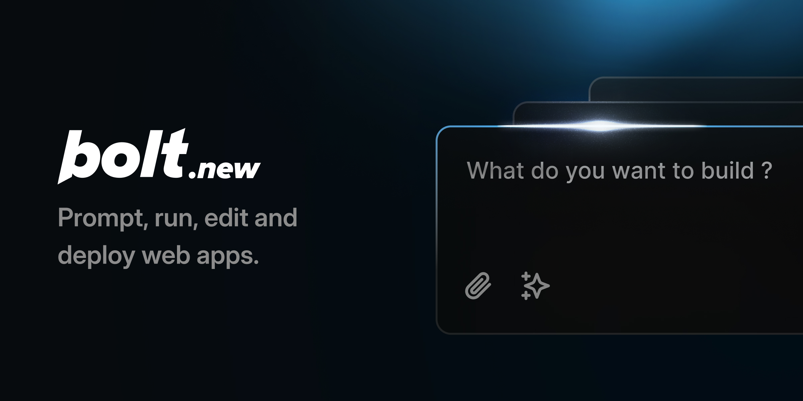

[](https://github.com/SomeshTalligeriDEV/bitcode)

# Contributing to Bitcode Studio

Bitcode Studio combines the capabilities of AI with a sandboxed, in-browser development environment (WebContainers) so an AI model and a developer can build full-stack apps together — now extended with first-class tooling for the **Bittensor** network: subnet scaffolding, a local node runner, a chain explorer, and a browser wallet.

Bitcode Studio is built with [Remix](https://remix.run/) and uses the [AI SDK](https://github.com/vercel/ai) to talk to an OpenAI-compatible model backend (Chutes by default, configurable).

## Project layout

```
app/                  Bitcode Studio UI (editor, chat, workbench, wallet, scan)
app/lib/.server/llm/  AI provider wiring, system prompt, streaming
app/lib/runtime/      Parses AI output into file writes / shell actions
functions/            Cloudflare Pages entry
```

See the parent `bitcode-spec/` folder for the full architecture and feature specs.

## Local development

```bash
git clone https://github.com/SomeshTalligeriDEV/bitcode.git
cd bitcode/editor--main
pnpm install
```

Copy `.env.example` to `.env.local` and set your model API key (`CHUTES_API_KEY` by default). Never commit real keys.

```bash
pnpm run dev
```

## Testing

```bash
pnpm test        # run once
pnpm test:watch  # watch mode
```

## Deployment (Cloudflare Pages)

```bash
pnpm run build
pnpm run deploy
```

## Credits

This project started from the open-source [bolt.diy](https://github.com/stackblitz-labs/bolt.diy) codebase (MIT License, originally by StackBlitz) and its WebContainer-based agent architecture.
