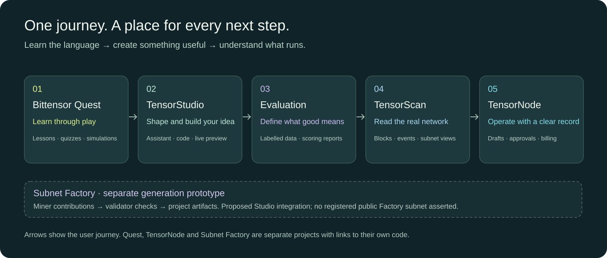

# The TensorStudio ecosystem

TensorStudio brings idea exploration, interface building, task evaluation and network observation into one workspace. The related projects below address learning, public visibility, operator workflows and a possible future generation backend. They are separate applications and repositories; a link between them does not establish an integration.

## Choose a starting point

| Your goal | Start here | What to expect |
| --- | --- | --- |
| Understand Bittensor | [Bittensor Quest · game](https://bittensor-quest-learn.someshtalligeri12.chatgpt.site/#game) | Public lessons, quizzes and local code simulations; profile, progress and notes stay in your browser |
| Turn an idea into an inspectable project | [TensorStudio](https://tensorstudio-workbench.vercel.app) | Guided conversation, editable files, previews, task recipes and offline evaluation; execution requires owner access |
| See what is happening on testnet | [TensorScan](https://tensorscan.vercel.app/scan?network=test) | Public, read-only chain observations |
| Review the operator workspace | [TensorNode source](https://github.com/SomeshTalligeriDEV/tensornode) | Private repository and a recorded demonstration of zero-spend job drafts |
| Explore contribution-based generation | [Subnet Factory source](https://github.com/aditya-541/sub) | Public development code for miner/validator contributions and project assembly |

## Bittensor Quest: learn before you configure

Quest covers TAO fundamentals, subnet markets, miners and validators, Yuma Consensus, Dynamic TAO and building with Bittensor. Lessons, quizzes and Code Lab simulations run locally without API credits. The optional AI tutor has separate credit requirements. Use **Start Exploring** to enter; arrow keys or WASD move and **E** opens a conversation. In the Learning panel, choose **TAO Fundamentals**, select **The native token of Bittensor**, and press **Check Answer**. Then choose **Start Code Challenge**, complete the classroom function and press **Run Local Tests**. Open **Progress** to review completed lessons. The recorded walkthrough verified the quiz, four passing local tests and browser-local progress. Your XP, profile, progress and notes are stored in the current browser.

## TensorStudio and TensorScan

**Studio** is the browser workbench. Its assistant helps shape the idea; the builder exposes the interface and code; subnet setup makes the task and evaluation rules explicit. The runner assembles reviewed templates, evaluates example responses and manages development processes.

**TensorScan** shows independent observations from the selected chain. Seeing a local process run and seeing an on-chain participant are different checks. Neither alone proves accepted work or rewards.

| Reference | Link |
| --- | --- |
| Studio repository · private | [SomeshTalligeriDEV/tensor_studio-](https://github.com/SomeshTalligeriDEV/tensor_studio-) |
| Web application | [apps/web](https://github.com/SomeshTalligeriDEV/tensor_studio-/tree/main/apps/web) |
| Execution service and templates | [apps/runner](https://github.com/SomeshTalligeriDEV/tensor_studio-/tree/main/apps/runner) |
| Bittensor connections | [Integration guide](../BITTENSOR-INTEGRATION.md) |
| Five-minute walkthrough | [Developer journey video](../media/TensorStudio-developer-journey-5min.mp4) |
| Local setup and user journey | [Main README](../../README.md#start-building) |

## TensorNode: an operator workspace

TensorNode is a separate **Rust, Next.js and PostgreSQL** project for operator workflows. Its first target is **Lium, subnet 51**. A job draft lets an operator record intended work before committing spend.

The existing demonstration shows creation and persistence of a **zero-spend draft**, stored events and live event updates, a billing read, the correctly absent execution receipt, and cancellation of the draft. It does **not** establish verified paid GPU provisioning or completed compute execution. TensorNode is not integrated into the hosted Studio deployment.

| Reference | Link |
| --- | --- |
| Repository · private | [SomeshTalligeriDEV/tensornode](https://github.com/SomeshTalligeriDEV/tensornode) |
| Recorded working demonstration | [TensorNode-professional-working-demo.mp4](https://github.com/SomeshTalligeriDEV/tensornode/blob/main/media/application-demo/TensorNode-professional-working-demo.mp4) |
| Dashboard | [dashboard](https://github.com/SomeshTalligeriDEV/tensornode/tree/main/dashboard) |
| Rust components | [crates](https://github.com/SomeshTalligeriDEV/tensornode/tree/main/crates) |
| Orchestrator | [orchestrator](https://github.com/SomeshTalligeriDEV/tensornode/tree/main/crates/orchestrator) |
| Services | [services](https://github.com/SomeshTalligeriDEV/tensornode/tree/main/services) |

Private links require repository access. The recording is evidence of the demonstrated draft workflow, not evidence of a live paid service.

## Subnet Factory: a proposed generation backend

[Subnet Factory](https://github.com/aditya-541/sub) explores how contributors could help generate projects. **Miners** submit typed contributions: structured results with defined fields. **Validators** check signed requests and baseline requirements before assembly. A queue tracks work, and server-sent events stream updates to a client.

This is a possible future backend for generation workflows. There is no public registered Factory subnet established by the current evidence. Its health describes local development, and the observed live build record failed because `FACTORY_NETUID` was missing. A netuid is the numeric identifier of a Bittensor subnet. Do not interpret that build record as successful network execution or assume Factory serves Studio's hosted assistant.

| Reference | Link |
| --- | --- |
| Repository · public | [aditya-541/sub](https://github.com/aditya-541/sub) |
| Implementation | [subnet_factory](https://github.com/aditya-541/sub/tree/main/subnet_factory) |

## How the pieces could grow together

The practical journey today is to **learn in Quest, develop in Studio and observe with TensorScan**. TensorNode provides a separate operator-workflow direction. Subnet Factory provides a separate contribution and generation direction. Connecting those projects would require explicit interfaces, authentication, deployment and end-to-end validation.

Team subscriptions, managed runners, evaluation services and operator infrastructure are potential commercial products. They are proposals, not evidence of sales or guaranteed Bittensor rewards. See the [business model](BUSINESS-MODEL.md) and the [operating boundaries](../../README.md#operating-boundaries).
